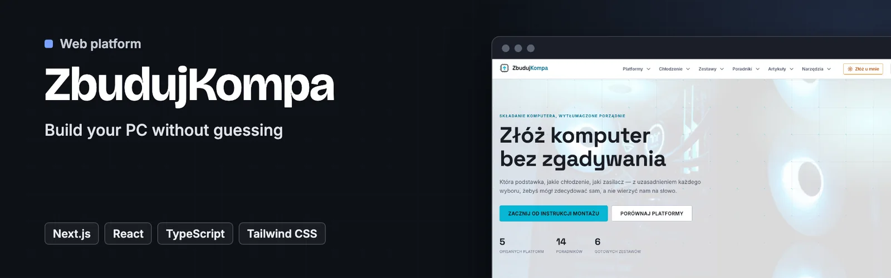
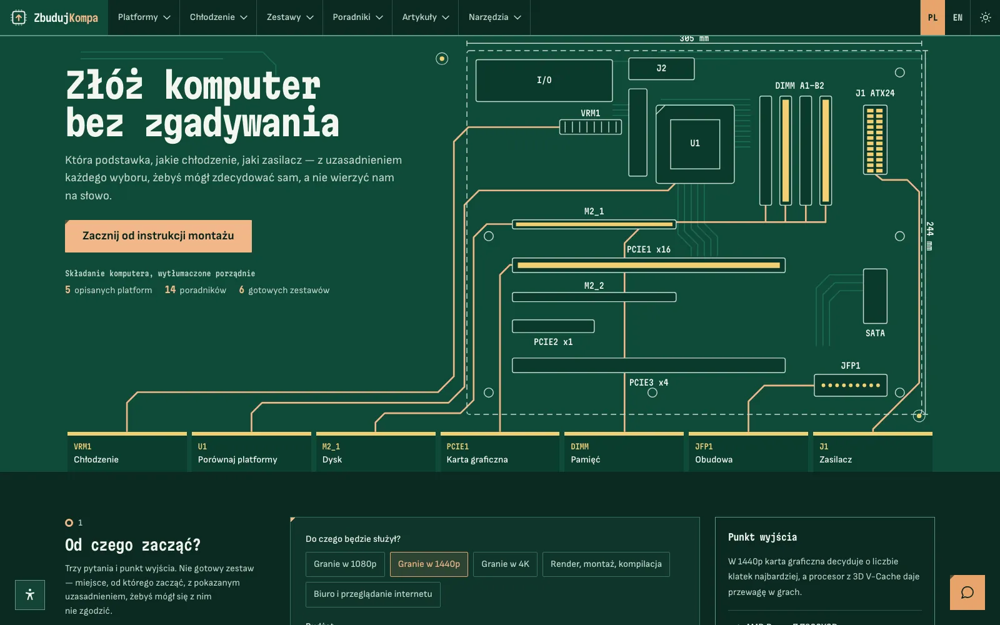
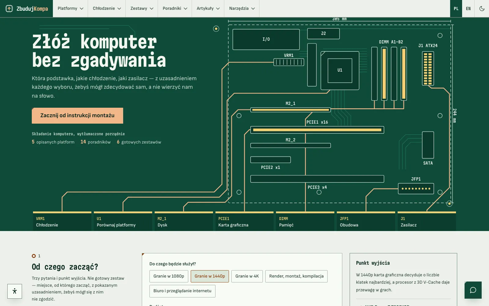
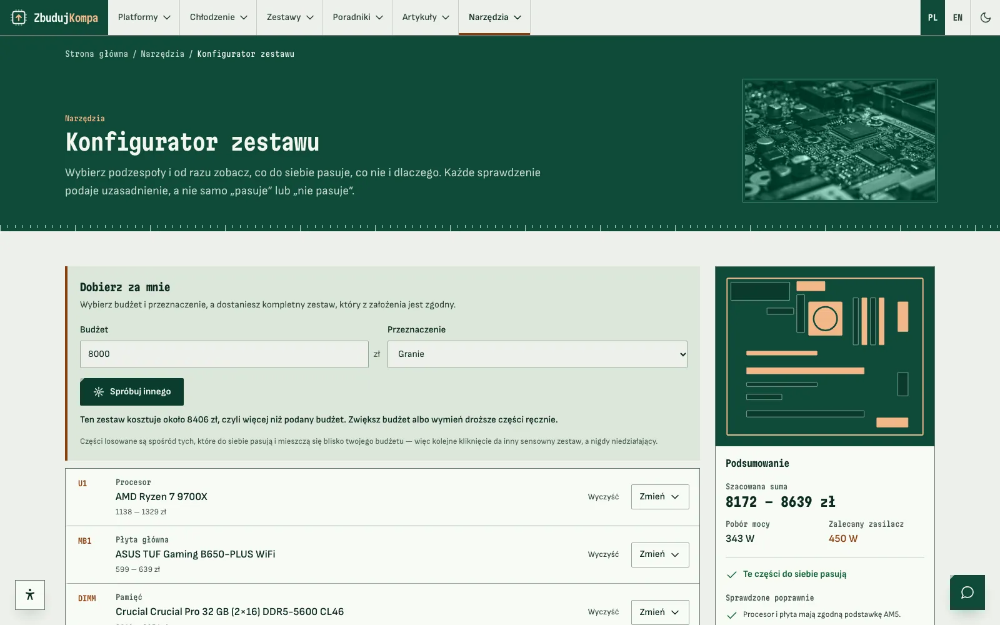
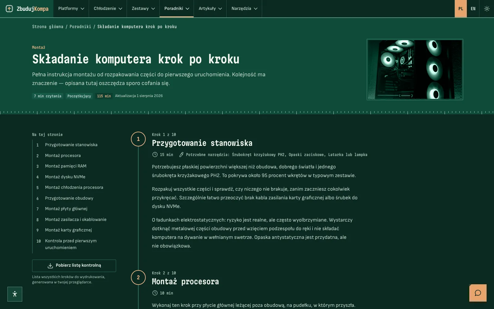
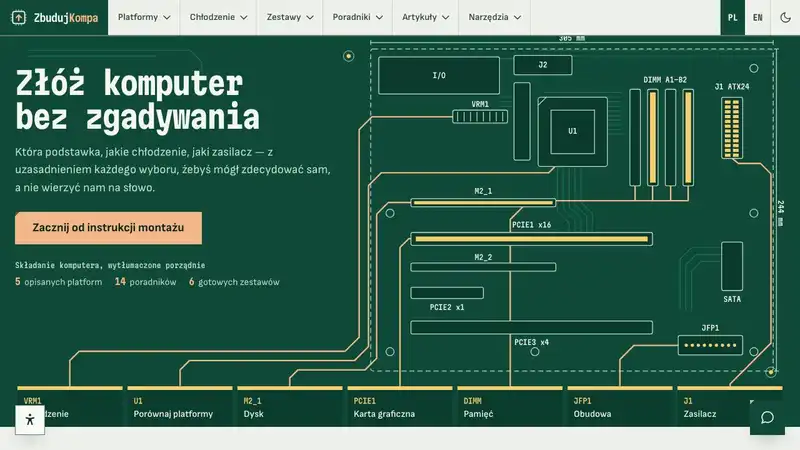

<p align="center">
  <a href="https://zbudujkompa.dawidolko.pl/pl/"></a>
</p>

# ZbudujKompa

> 🚀 **Build your PC without guessing** - a bilingual, fully static reference site that explains the reasoning behind every hardware recommendation

**ZbudujKompa** is a reference site for anyone assembling a computer, published in Polish and English. It covers CPU platforms and sockets, cooling classes, a catalogue of real components, complete reference builds and step-by-step assembly guides — including installing Windows and Linux, which most build guides skip entirely. Each recommendation ships with the reasoning behind it rather than just the verdict.

There is no backend, no database and no tracking. Everything is prerendered to files and served by GitHub Pages. The interactive parts — the configurator, the calculators, the assistant — all run in the browser.

[](https://github.com/dawidolko/ZbudujKompa/actions/workflows/deploy.yml)


**[Live site](https://zbudujkompa.dawidolko.pl/pl/)** · [Screenshots](#️-screenshots) · [Getting started](#-getting-started)

---

## 🎯 Key Features

- 🧩 **Configurator** — Pick parts from a catalogue of 100 components and get live compatibility checks: socket, memory generation, VRM capacity, physical clearances and supply headroom, each explaining its reasoning
- 🔩 **Components** — Every part carries a checked Polish price range with its date and live links to Ceneo, Allegro and Amazon.pl, and a price is hidden once its check is over 45 days old, with the specifications that actually decide a build: cooler height, card length, module height
- 🖥️ **Platforms** — Five AMD and Intel sockets with chipset tables and an honest verdict on which are still worth buying into
- ❄️ **Cooling** — Five cooling classes compared on heat handled, noise and price, with the trade-offs stated plainly
- 📖 **Guides** — Fourteen step-by-step guides: assembly, first boot, BIOS, Windows and Linux installation, overclocking, quiet builds, diagnostics and maintenance
- 🧮 **Calculators** — Fourteen calculators covering supply sizing with ATX 3.x transients, physical clearance, running cost, acoustics, thermals, display bandwidth and memory latency, each showing its working
- 📰 **Articles** — Analysis, buying advice, news and explainers, with perishable pieces flagged by age rather than presented as current indefinitely
- 💬 **Assistant** — A docked chat assistant answering from a local knowledge base, with no API key required and an optional LLM layered on top
- 🌐 **Bilingual** — Every route exists in Polish and English with correct `hreflang`, `lang` and canonical URLs; Polish is the default
- 🎨 **Design** — Laid out as a hardware service manual: an interactive board drawing, a side index on guides, and datasheet tables, in both themes. See [Design](#-design)
- ♿ **Accessible** — WCAG 2.2 Level AA in both light and dark themes, verified by an automated axe suite

---

## 🖼️ Screenshots

| Home page — dark theme                                                     | Home page — light theme                                                      |
| -------------------------------------------------------------------------- | ---------------------------------------------------------------------------- |
|  |  |

| Build configurator                                                                                                     | Assembly guides                                                                                          |
| ---------------------------------------------------------------------------------------------------------------------- | -------------------------------------------------------------------------------------------------------- |
|  |  |

Both themes meet WCAG 2.2 AA, and the choice survives a language switch.

---

## 🎨 Design

ZbudujKompa reads as a hardware service manual printed on a circuit board. That follows from what the site is: a reference someone keeps open while building.

- **The board.** The home page opens on a drawing of an ATX board with the real 305 × 244 mm proportions, and its gold edge connector is the way into the site. Each finger is a link, and a copper trace runs from it to the part it covers. Hovering or focusing either end lights the whole net using CSS `:has()`, so it needs no script. The drawing, the annotated [`MotherboardMap`](src/components/diagrams/MotherboardMap.tsx) and the configurator's status board all read one table, [`boardLayout.ts`](src/components/diagrams/boardLayout.ts).
- **Substrate and metal.** The page is pale drawing paper in the light theme and deep solder mask in the dark one. Copper is the accent and gold marks contacts. A block marked `.mask` is always a board, whichever theme is active: the class redefines the semantic tokens for its subtree, so components work on it unchanged.
- **Type.** [Sofia Sans](https://github.com/lettersoup/Sofia-Sans), which comes from DIN engineering lettering, is used for reading. [Martian Mono](https://github.com/evilmartians/mono) is used for headings, figures and references. Both are woff2 subsets with the Polish letters, 19 KB and 10 KB, served from this site. Their licence is in [`src/fonts/OFL.txt`](src/fonts/OFL.txt).
- **Documentation layout.** Home page sections are numbered chapters with the title in the margin. Guides and articles keep a side index beside the text that marks the section being read. Procedures are numbered steps joined by one trace. Part lists are bills of materials with part numbers, not card grids, and tables are datasheets. The footer is a drawing's title block.
- **Motion.** There is one moment: on load the traces route themselves from the connector to the parts. The finished drawing is the resting state, so with reduced motion or stopped animations you simply see it.

---

## 🧩 Modules

| Module                  | Description                                                                                                       | Stack                                          |
| ----------------------- | ----------------------------------------------------------------------------------------------------------------- | ---------------------------------------------- |
| **Configurator**        | Part pickers, browser and comparison view, backed by the compatibility engine in `src/lib/parts/compatibility.ts` | React 19 client components, TypeScript         |
| **Calculators**         | Fourteen pure formula modules in `src/lib/calculators.ts`, testable without a browser                             | TypeScript                                     |
| **Chat assistant**      | Local knowledge base with an optional OpenAI-compatible provider on top                                           | `src/lib/chat`, `src/components/chat`          |
| **Guides & articles**   | Guide and blog content split by subject, rendered with anchored steps and diagrams                                | `src/lib/guides`, `src/lib/blog`               |
| **Diagrams**            | Hand-authored technical SVG drawings                                                                              | `src/components/diagrams`                      |
| **i18n**                | Locale config plus PL/EN dictionaries driving every route                                                         | `src/i18n`                                     |
| **Accessibility panel** | In-page preference panel with its own test suite                                                                  | `src/components/layout/AccessibilityPanel.tsx` |

---

## 🎬 Demo

<p align="center">
  
</p>

---

## 🛠️ Technology Stack

### Frontend

- **Next.js 16** — App Router with a full static export (`output: 'export'`)
- **React 19** — Server and Client Components
- **TypeScript 5.7** — `strict` mode; a type error fails the production build
- **Tailwind CSS 4** — CSS-based configuration via `@tailwindcss/postcss`

### Tooling & Quality

- **ESLint 9** with `eslint-config-next`
- **Prettier 3** for formatting
- **Playwright** and **axe-core** (`@axe-core/playwright`) for browser and accessibility suites
- **sharp** for the photo optimisation pipeline

### Infrastructure

- **GitHub Actions** — verify → test → build → deploy on every push to `main`
- **GitHub Pages** — static hosting on a custom domain via `public/CNAME`
- **Docker** — three-stage build ending in an nginx runtime (`.tools/docker/`)
- **Node.js ≥ 22**

---

## 🚀 Getting Started

### Prerequisites

- **Node.js 22 or newer** (see `.nvmrc`)
- **npm**
- Optionally **Docker** for the containerised runtime

### 1. Clone the Repository

```bash
git clone https://github.com/dawidolko/ZbudujKompa.git
cd ZbudujKompa
```

### 2. Install Dependencies

```bash
npm ci          # install exactly what the lockfile pins
```

### 3. Run

```bash
npm run dev     # http://localhost:3000
```

Building and previewing the static export:

```bash
npm run build   # writes ./out
npm run serve   # http://localhost:3000
```

### Docker

```bash
npm run docker:up      # production image on http://localhost:8080
npm run docker:dev     # dev server with hot reload
npm run docker:down
npm run docker:logs
```

The production image is a three-stage build — dependencies, Next.js build, then an nginx runtime containing only the exported files. It runs as an unprivileged user with a read-only root filesystem. See [`.tools/docker/`](.tools/docker/).

### Configuration

Copy [`.env.example`](.env.example) to `.env.local`. Every variable is compiled into the static output, so treat all of them as public.

| Variable                   | Purpose                                                                          |
| -------------------------- | -------------------------------------------------------------------------------- |
| `NEXT_PUBLIC_SITE_URL`     | Canonical address used for metadata, Open Graph, structured data and the sitemap |
| `NEXT_PUBLIC_BASE_PATH`    | Sub-path prefix; empty for a custom domain, `/<repo>` for a project Pages site   |
| `NEXT_PUBLIC_CHAT_API_URL` | Optional OpenAI-compatible chat endpoint                                         |
| `NEXT_PUBLIC_CHAT_API_KEY` | Optional API key — see the warning below                                         |
| `NEXT_PUBLIC_CHAT_MODEL`   | Optional model name                                                              |

`SERPAPI_KEY` is different: it is a GitHub Actions secret for the price refresh, is never compiled into the site, and must not go in `.env.local`. See [Prices](#-prices).

---

## 💰 Prices

The site is static, so it cannot show live prices. Instead each price is checked on a known day and that day is shown beside it. Once a check is more than 45 days old the price is not shown at all: the figure and every total that includes it are replaced by "Check current price" and the live links. Live links per part open the current search on Ceneo, Allegro and Amazon.pl, with no affiliate tags.

**What a range means:** the low end is the lowest sensible price for a new unit, usually the Ceneo lowest with several shops behind it. The high end is the typical in-stock price at a mainstream shop. For cards with many models, that is the median of the listings seen, taking the lower middle value of an even set, so a range only holds prices a shop displayed.

**How the age limit is enforced:** every figure goes through one component, [`Price`](src/components/parts/Price.tsx), and a total carries the oldest date among its parts. The limit is applied three times. The build judges the static HTML against its own date, and a daily scheduled deploy keeps that current. The browser judges it again against the reader's clock. A small head script hides expired figures before the first paint, so they never show while the page hydrates. Budget logic, such as the automatic build and the upgrade calculator, keeps using stored values and labels them as an estimate. A total of many parts shows the prompt alone, with the live links next to each of its parts or, on the builds overview, on the build's own page.

**Where the data is:** [`src/lib/parts/prices.ts`](src/lib/parts/prices.ts) is the only place a price is written. Each record has `min`, `max`, `tier`, `checkedAt` and `sources`, plus an optional `note` on how the figures were chosen. Cooling class ranges are there too, as `class:` records.

**Parts with no price:** when a part is discontinued or has no credible offer, its `min` and `max` are `null` and `reason` says why. The interface shows "No price", autopick skips the part, and totals state how many parts they exclude. Out-of-stock prices are not used as evidence, because they turned out to be stale.

### Data sources

| Source                        | Used for                     | Status                                                                                                                                      |
| ----------------------------- | ---------------------------- | ------------------------------------------------------------------------------------------------------------------------------------------- |
| Ceneo, x-kom, Morele, Proline | The figures in `prices.ts`   | Read by hand on the check date. The site never fetches them, and scraping them in code breaks their terms                                   |
| SerpApi Google Shopping       | The optional monthly refresh | Ready for a key. **Has not yet run against the real API**                                                                                   |
| Amazon Creators API           | Not used                     | Needs an Associates account with [10 qualifying sales in 30 days](https://affiliate-program.amazon.com/creatorsapi/docs/en-us/introduction) |
| Allegro API                   | Not used                     | Public listing access could not be confirmed                                                                                                |
| Geizhals                      | Not used                     | No free public data API, and it refuses automated requests                                                                                  |

### How to refresh

**By hand:** check each part, edit `src/lib/parts/prices.ts`, and set `checkedAt`. If a price leaves its tier's limits in [`price-tiers.ts`](src/lib/parts/price-tiers.ts), update `tier` in the same record. A large market move also has to go into `BUDGET_SPLIT` in `src/lib/parts/autopick.ts`.

**Automatically:** create a free account at [SerpApi](https://serpapi.com/), then add the key as a repository secret named `SERPAPI_KEY`. `.github/workflows/update-prices.yml` then runs on the 3rd of each month, or on demand from the Actions tab. Without the secret it exits cleanly and changes nothing.

- The free plan allows 250 searches a month and 50 an hour. The catalogue uses one search per part, so a run fits the month and waits 75 seconds between searches to fit the hour. That makes a run take about two hours.
- For each part the script keeps Polish-priced offers whose title really is that part, drops used stock, foreign marketplaces and outliers, then writes the lowest remaining offer and the median. A part with fewer than three matches keeps its previous record and date, so it reaches the age limit and is hidden rather than given a false date.
- A part whose typical price leaves its tier by more than 10 percent moves to the tier that fits. The limits per category are in [`price-tiers.ts`](src/lib/parts/price-tiers.ts).
- A part with no price is restored once at least five reliable offers return. Priced parts are searched first, so a quota that runs out costs restorations rather than prices on show. `manual` records are skipped.
- A run that refreshes fewer than half of the priced parts writes nothing, so a broken key or feed cannot overwrite good data. A run that stops later keeps what it found. Either way, when the key exists and the refresh failed, the workflow ends in failure.
- Otherwise it commits the file, dates included, then starts a deploy.

Before relying on it, do one supervised run and review the diff: the parsing is tested against a [hand-written sample](tests/fixtures/serpapi-google-shopping.sample.json) shaped from the documentation, and the Polish price format in it is an assumption. On the free plan, SerpApi's Legal Shield does not apply, and its terms leave responsibility for how the data is used with you. Google's DMCA suit against SerpApi was dismissed in July 2026 with leave to amend, so check where that stands.

---

## 🧠 The Build Configurator

The [configurator](https://zbudujkompa.dawidolko.pl/pl/konfigurator/) is the piece with the most logic behind it. It re-checks on every change rather than behind a submit button, so a conflict appears while the choice that caused it is still on screen.

Findings come in three grades, and the middle one is the point:

- **Error** — the build cannot work. A DDR4 kit will not enter a DDR5 slot.
- **Warning** — it works, but something is compromised. A board whose VRM is below the CPU's peak draw does not fail; it quietly reduces clocks under sustained load, which is exactly the kind of problem nobody notices.
- **Pass** — checked and fine, stated explicitly so the reader knows it was considered.

Every message explains itself. `Incompatible` on its own sends someone back to a forum; _"this board takes DDR5 and that kit is DDR4"_ tells them what to change.

The engine lives in [`src/lib/parts/compatibility.ts`](src/lib/parts/compatibility.ts) and is covered by [15 tests](tests/compatibility.spec.mjs).

---

## 💬 The Chat Assistant

The assistant in the bottom-right corner matches questions against a knowledge base compiled into the site. **It works offline, costs nothing per message, and needs no API key.**

An optional LLM can be layered on top with a free-tier key from [Groq](https://console.groq.com/keys), [OpenRouter](https://openrouter.ai/keys) or [Cerebras](https://cloud.cerebras.ai):

```bash
npm run chat:key -- gsk_your_key_here    # verifies the key, then writes .env.local
npm run dev
```

**Any failure falls back to the local answer** — rate limit, bad key, no network, or a 15-second timeout. The assistant never stops answering.

> **Before adding a key to a public deployment.** This is a static export. A GitHub Secret is secret in the Actions log, not in the built site: the value is compiled into the JavaScript bundle and served to every visitor. Only use a free-tier key, with a hard spending limit, that you are prepared to rotate. `npm run check:secrets` scans tracked files for keys and runs first in CI.

To enable it on Pages, add `CHAT_API_URL`, `CHAT_API_KEY` and `CHAT_MODEL` as repository secrets. Leaving them unset is fully supported.

---

## ♿ Accessibility

The site targets WCAG 2.2 Level AA. [`tests/a11y.spec.mjs`](tests/a11y.spec.mjs) runs axe against a page from every section **in both themes** — a contrast failure can exist in one theme and not the other, so a single-theme audit misses half of them.

- Every text/background pair is documented with its measured contrast ratio in [`globals.css`](src/app/globals.css), so a future change can be checked against the number it has to beat.
- Colour is never the sole carrier of meaning: every status pairs colour with an icon and a text label.
- Focus is always visible, meets the 3:1 indicator contrast of SC 2.4.13, and returns to the triggering control when a panel closes.
- `prefers-reduced-motion`, `prefers-contrast` and `forced-colors` are all honoured. Nothing depends on animation to become visible.
- Interactive targets meet the 24×24 minimum of SC 2.5.8.
- An in-page [accessibility panel](src/components/layout/AccessibilityPanel.tsx) exposes the preferences directly, with its own suite in `tests/accessibility-panel.spec.mjs`.

An accessibility panel in the corner of every page changes text size, contrast, font and motion, and remembers the choice on the device. It sits on top of the markup and does not replace accessible markup.

Automated testing catches roughly a third of accessibility problems. Passing the suite is a floor, not a certificate — known gaps are listed on the site's own [accessibility page](https://zbudujkompa.dawidolko.pl/pl/dostepnosc/), served from `src/app/[locale]/dostepnosc/`.

---

## 🧪 Testing

```bash
npm run verify   # secrets, typecheck, lint, formatting, build
npm run test     # chat, compatibility, calculators, prices, theme, a11y panel, price age, interaction, accessibility
```

The browser suites need a built site running — `npm run build && npm run serve` first, or point them elsewhere with `TEST_BASE_URL`.

| Suite                                | Covers                                                                                  |
| ------------------------------------ | --------------------------------------------------------------------------------------- |
| `tests/chat.spec.mjs`                | Question matching in both languages, including off-topic questions that must be refused |
| `tests/compatibility.spec.mjs`       | The configurator engine, and that every reference build fits and can be bought          |
| `tests/calculators.spec.mjs`         | Every calculator formula, without a browser                                             |
| `tests/prices.spec.mjs`              | Price data integrity, the age limit, tiers, and the refresh, with its refusal rules     |
| `tests/price-age.spec.mjs`           | With a shifted clock, that no expired figure is shown, even before hydration            |
| `tests/theme.spec.mjs`               | Theme persistence across language switches, and no flash on load                        |
| `tests/accessibility-panel.spec.mjs` | The in-page accessibility preferences panel                                             |
| `tests/interaction.spec.mjs`         | Menu, assistant, calculators, glossary filter                                           |
| `tests/a11y.spec.mjs`                | axe against every section, in both themes                                               |

Individual suites are also available as `npm run test:chat`, `test:compat`, `test:calc`, `test:prices`, `test:theme`, `test:a11ypanel`, `test:priceage`, `test:interaction` and `test:a11y`.

---

## 📁 Project Structure

```
ZbudujKompa/
├── .github/workflows/     # CI: verify → test → build → deploy
├── .tools/
│   ├── docker/            # Dockerfile, compose, nginx, security headers
│   └── scripts/           # Brand assets, photo pipeline, chat key, secret scanning
├── docs/screenshots/      # README imagery
├── scripts/               # Optional monthly price refresh through SerpApi
├── public/                # Icons, OG image, photos, videos, manifest, CNAME
├── src/
│   ├── app/
│   │   ├── [locale]/      # Every content route, both languages
│   │   ├── globals.css    # Design tokens with documented contrast ratios
│   │   ├── robots.ts
│   │   └── sitemap.ts
│   ├── components/
│   │   ├── blog/          # Article rendering
│   │   ├── chat/          # Build assistant
│   │   ├── configurator/  # Part pickers, browser and comparison
│   │   ├── diagrams/      # Technical SVG drawings and the shared board layout
│   │   ├── guides/        # Side index and checklist
│   │   ├── layout/        # Header, footer, theme, language, accessibility panel
│   │   ├── parts/         # The expiring price, its check date and live price links
│   │   ├── tools/         # Calculators and utilities
│   │   └── ui/            # Buttons, badges, cards, photos, icons
│   ├── fonts/             # Self-hosted font subsets and their licence
│   ├── i18n/              # Locale config and PL/EN dictionaries
│   └── lib/
│       ├── parts/         # Component catalogue, price data and compatibility engine
│       ├── blog/          # Articles and news
│       ├── chat/          # Knowledge base and provider
│       ├── guides/        # Guide content, split by subject
│       ├── calculators.ts # Every formula, testable without a browser
│       └── theme.ts       # Theme resolution and persistence
└── tests/                 # Chat, compatibility, calculators, prices, theme, interaction, a11y
```

### Three decisions worth knowing

**The document shell lives in `[locale]/layout.tsx`, not the root layout.** The `lang` attribute has to be correct in the _served_ HTML, and the locale segment is the only place that knows the language.

**Navigation, sitemap and routes derive from the data modules.** Adding a socket to `src/lib/sockets.ts` puts it in the menu, the footer, the sitemap and its own generated page. There is no second list to keep in step.

**The theme is an attribute, re-applied after navigation.** Each locale renders its own `<html>`, and Next.js treats a link between them as a client-side navigation — so the new document's `<head>` script never runs and React drops the attribute. A blocking script handles the cold load and [`ThemeScript`](src/components/layout/ThemeScript.tsx) handles the soft navigation. Both halves are needed; [five tests](tests/theme.spec.mjs) cover the combinations.

---

## 🚢 Deployment

Pushing to `main` runs [`deploy.yml`](.github/workflows/deploy.yml): verify → test → build → deploy. The deploy depends on the tests, so a build that fails typecheck, lint, formatting or accessibility never reaches production.

For a project site at `https://<user>.github.io/<repo>/`, set `NEXT_PUBLIC_BASE_PATH=/<repo>`. On a custom domain — as here, via `public/CNAME` — leave it empty.

---

## 🤝 Contributing

Corrections to the technical content are especially welcome; hardware advice ages, and an issue pointing at something now wrong is genuinely useful. Please keep commits following [Conventional Commits](https://www.conventionalcommits.org/) and run `npm run verify` before opening a pull request.

Photographs are credited in [`public/photos/CREDITS.md`](public/photos/CREDITS.md) and used under the [Unsplash Licence](https://unsplash.com/license).

---

## 📄 License

This project is open source and available under the [MIT License](LICENSE).

---

## 👨‍💻 Author

**Dawid Olko** · Fullstack / AI Developer

[Portfolio](https://olkodawid.dawidolko.pl) · [CV](https://cv.dawidolko.pl) · [LinkedIn](https://www.linkedin.com/in/dawidolko/) · [GitHub](https://github.com/dawidolko)
